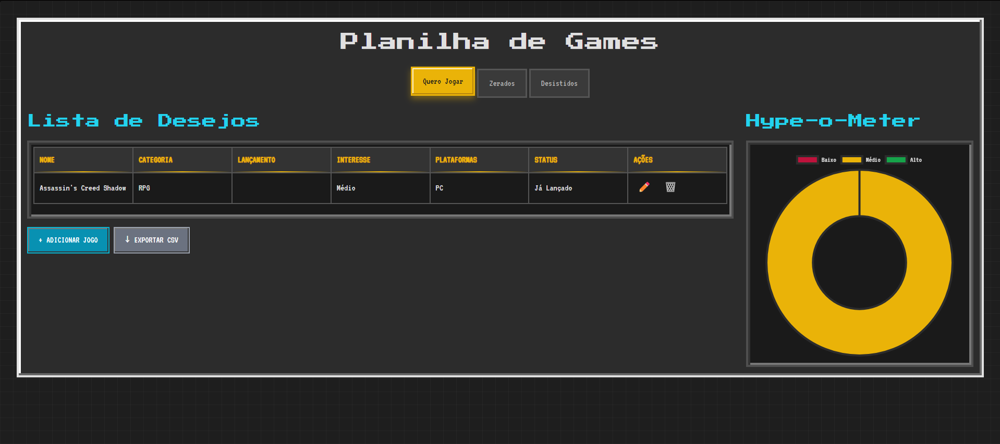

# 🎮 Bit Tracker

> **Organize sua vida gamer** com estilo retrô!
> Aplicação web interativa com design pixelado para gerenciar **jogos que quer jogar**, **jogos zerados** e **jogos desistidos** — com gráficos, estatísticas, autocomplete via RAWG.io e suporte a PWA.

---

## 🕹 Funcionalidades

### 📜 Quero Jogar

- Lista de desejos com nome, categoria, data de lançamento, interesse, plataformas e status
- **Autocomplete via RAWG.io** — preenche capa, categoria, plataformas, data e status automaticamente
- **Modo kanban** — alterna entre tabela e grade de cards com capas
- **Fixar no topo** — destaque jogos prioritários
- **Dias na fila** — veja há quanto tempo cada jogo está esperando
- **O que jogar hoje?** — sorteia um jogo aleatório com animação
- Botão para mover diretamente para Zerados
- Exportação em **CSV**

---

### 🏆 Jogos Zerados

- Hall da Fama com nome, categoria, nota em estrelas, data, plataforma, tempo gasto e avaliação
- **Modo kanban** com capas dos jogos
- **Metas anuais** — defina uma meta de jogos para o ano e acompanhe o progresso
- **Relatório mensal** — estatísticas de jogos zerados, horas e nota média por mês
- **Exportar como imagem** — salva a aba como PNG
- Confete ao registrar um novo jogo zerado 🎉
- Estatísticas com total zerado, tempo médio e gráfico de notas
- Exportação em **CSV**

---

### 👻 Jogos Desistidos

- Cemitério Gamer com nome, categoria, motivo, tempo jogado e observações
- **Modo kanban** com capas dos jogos
- Gráfico com motivos de desistência
- Exportação em **CSV**

---

### 🔍 Modal de Detalhes

- Visualização completa de todos os campos do jogo
- **Nota da comunidade RAWG** com barra de progresso visual

---

## 📊 Recursos Gerais

- **Gráficos dinâmicos** com [Chart.js](https://www.chartjs.org/)
- **Persistência de dados** no `localStorage`
- **Busca e filtro** em tempo real em todas as abas
- **Ordenação** por qualquer coluna
- **Importação CSV**
- **Notificações (toast)** para ações
- **Modais** estilizados com bloqueio de scroll
- **PWA** — instalável como app, funciona offline (service worker com estratégia cache-first)
- **Atalhos de teclado**:
  - `Ctrl + 1` → Aba Quero Jogar
  - `Ctrl + 2` → Aba Zerados
  - `Ctrl + 3` → Aba Desistidos
  - `ESC` → Fecha modais

---

## 🖼 Prévia



---

## 🚀 Tecnologias

- **HTML5 / CSS3 / JavaScript (ES6+)**
- **Tailwind CSS** — utilitários de layout e responsividade
- **Chart.js** — gráficos
- **RAWG.io API** — autocomplete e metadados de jogos
- **html2canvas** — exportação como imagem
- **canvas-confetti** — celebração ao zerar
- **Lucide Icons** — ícones SVG
- **LocalStorage** — persistência local
- **Service Worker** — suporte offline / PWA

---

## 📦 Como Usar

1. Clone o repositório

   ```bash
   git clone https://github.com/cssbreno/bittracker.git
   ```

2. Sirva localmente (necessário para o Service Worker)

   ```bash
   # Qualquer servidor estático, ex:
   npx serve .
   ```

3. Acesse `http://localhost:3000/bittracker/` no navegador

> Para uso simples sem PWA, abrir `index.html` diretamente no navegador também funciona.

---

## 💾 Estrutura de Arquivos

```
📂 bittracker
 ├── index.html        # Estrutura principal
 ├── manifest.json     # Manifesto PWA
 ├── sw.js             # Service Worker
 ├── favicon.ico
 ├── css/
 │   └── style.css     # Estilo pixelado e responsividade
 └── js/
     └── script.js     # Lógica, gráficos e interações
```

---

## 🏹 Roadmap

- [x] Validação de formulários
- [x] Autocomplete com capas via RAWG.io
- [x] Modo kanban (grade de cards)
- [x] Fixar jogos no topo da lista
- [x] Dias na fila
- [x] Sortear jogo aleatório
- [x] Metas anuais de jogos zerados
- [x] Relatório mensal de estatísticas
- [x] Exportar aba como imagem PNG
- [x] Nota da comunidade RAWG no modal de detalhes
- [x] PWA com suporte offline
- [ ] Autenticação de usuário
- [ ] Suporte a múltiplos usuários / sincronização em nuvem

---

## 📜 Licença

Uso livre para fins de estudo e diversão gamer. 🎮
Sinta-se à vontade para modificar e compartilhar!
